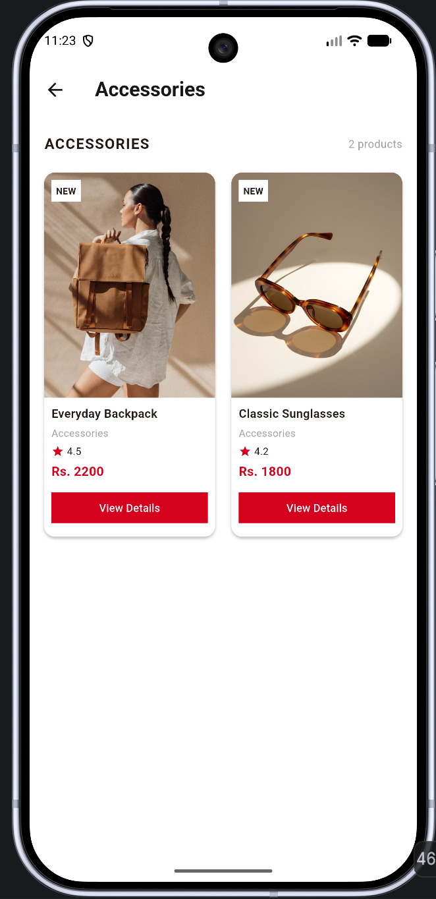

# Rosabee – Flutter Shopping App

# Project Information

- Project Name: Rosabee
- Project Type: Mini E-Commerce Mobile Application
- Framework: Flutter
- Programming Language: Dart
- Student Name: Armita Thapa Magar
- Student ID: 2439474
- Course/Module: CIS099-2 Mobile Application Development

# Project Description

Rosabee is a Flutter-based mini e-commerce application designed to provide users with a simple and 
attractive shopping experience. The application displays products across different categories and 
allows users to view detailed product information.

The interface features a clean design with a red accent color, promotional banners, product images, 
ratings, and prices.

# Features

- Home Page: Displays promotional banners, shopping categories, and trending products.
- Banner Carousel: Shows three promotional banners using the carousel_slider package.
- Product Categories: Displays six categories: Electronics, Shoes, Fashion, Accessories, Beauty, and Home.
- Category Filtering: Shows products belonging to the selected category.
- Product Cards: Displays product images, names, categories, ratings, and prices.
- Product Details: Shows the selected product's image, name, price, rating, and description.
- Add to Cart Feedback: Displays a SnackBar when the Add to Cart button is pressed.
- Shopping Bag Feedback: Displays a message when the shopping bag icon is pressed.
- Navigation: Allows users to move between the home page, category pages, and product details pages.

# Technologies Used

- Flutter
- Dart
- Material Design widgets
- carousel_slider package
- VS Code

# Project Structure

myshop/
├── lib/
│   ├── data/
│   │   └── product_data.dart
│   ├── models/
│   │   └── product.dart
│   ├── screens/
│   │   ├── category_page.dart
│   │   ├── home_page.dart
│   │   └── product_details_page.dart
│   ├── widgets/
│   │   ├── banner_carousel.dart
│   │   ├── category_item.dart
│   │   └── product_card.dart
│   └── main.dart
├── screenshots/
│   ├── category_page.png
│   ├── home_page.png
│   └── product_details_page.png
├── pubspec.yaml
└── README.md

# Application Screenshots

# Home Page

# Category Page

# Product Details Page

# How to Run the Application

1. Install Flutter and set up the Flutter development environment.
2. Clone or download the project repository.
3. Open the project directory in VS Code.
4. Open the terminal and run:

   flutter pub get

5. Start an emulator or connect a compatible device.
6. Run the application:

   flutter run

## Project Scope

Rosabee is a demonstration application developed for educational purposes. It focuses on Flutter UI
development, reusable widgets, product data modelling, category filtering, navigation, and basic user 
interaction.

The application does not include a backend, user authentication, real shopping cart storage, or
payment processing.

# Conclusion

This project demonstrates how Flutter can be used to develop a simple and visually appealing shopping 
application using reusable components, responsive layouts, product models, and interactive UI elements.